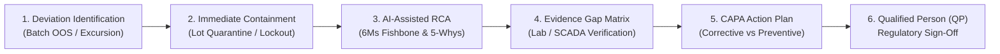

# BioSynth Quality Copilot: AI-Powered RCA & CAPA for API Manufacturing

BioSynth Quality Copilot is an enterprise-grade, cGMP and ICH Q7-compliant AI assistant designed for pharmaceutical quality professionals conducting investigations into Active Pharmaceutical Ingredient (API) deviations, Out-of-Specification (OOS) incidents, and process excursions.

---

## 1. Domain Background: Quality Workflow in API Manufacturing

In API chemical synthesis, crystallization, and isolation, quality incidents typically follow the standardized regulatory workflow:



### Key Differences in API Investigations:
- **Critical Quality Attributes (CQAs):** Related substances/impurities, crystal polymorphic form (PXRD), residual solvents (ICH Q3C), particle size distribution (PSD), assay, and moisture.
- **Critical Process Parameters (CPPs):** Crystallizer jacket cooling ramps, anti-solvent feed rate, reaction stoichiometry, agitation shear, drying vacuum and temperature.
- **Human-in-the-Loop Principle (GxP):** Under 21 CFR 211 and EU GMP Annex 16, AI-generated root cause hypotheses and CAPA actions are treated as **provisional suggestions** until verified with objective physical evidence (SCADA historian logs, analytical CoAs, maintenance calibration records) and confirmed by a Qualified Person (QP).

---

## 2. Mandatory Tech Stack Implementation

- **Frontend:** React 18, Redux Toolkit (`@reduxjs/toolkit`, `react-redux`), Tailwind CSS, Lucide Icons.
- **Backend:** Python 3.13, FastAPI, SQLAlchemy ORM, Pydantic, PyPDF.
- **AI Orchestration:** **LangGraph StateGraph** multi-agent workflow integrated with **Groq** (`llama-3.3-70b-versatile`, `gemma2-9b-it`).
- **Database:** SQLite (default zero-setup) and configurable PostgreSQL/MySQL via `DATABASE_URL`.
- **Intelligent Fallback:** High-fidelity ICH Q7 heuristic reasoning engine that guarantees immediate, realistic functionality even prior to entering a Groq API key.

---

## 3. Core AI Workflow & Interaction Pattern

BioSynth adheres to the interaction pattern where the user **does not manually fill the form as the primary workflow**:

1. **Intake Document / Deviation Report:**
   - Upload an official GxP PDF report, paste plain text or an email notification, or pick one of the 3 pre-loaded API manufacturing scenarios.
2. **Execute LangGraph StateGraph Workflow:**
   - **Node 1 (Extract Metadata):** Extracts incident ID, API name, batch number, stage, equipment, severity, and impacted CQAs/CPPs.
   - **Node 2 (6M Ishikawa Classification):** Categorizes potential factors across Man, Machine, Material, Method, Measurement, and Milieu.
   - **Node 3 (5-Whys Construction):** Builds an evidence-backed 5-Whys causal chain from the observable CQA failure down to the systemic root cause.
   - **Node 4 (Evidence Gap Analysis):** Highlights missing evidence, unverified logs, or pending tests required by regulatory auditors.
   - **Node 5 (CAPA Synthesis):** Recommends targeted Corrective Actions (immediate containment/repair) and Preventive Actions (plant-wide systemic recurrence prevention) with effectiveness checks.
3. **Interactive Human-in-the-Loop Review:**
   - Quality professionals can inspect suggestions section-by-section, click **"Apply to Form"**, edit any question, answer, or action inline, verify physical evidence, and electronically authorize with QP sign-off.
4. **Interactive Copilot Chat:**
   - Quality specialists can converse with the AI copilot in real time to delve into crystallization physics, ask for tighter CAPA effectiveness criteria, or probe utility logs.

---

## 4. Pre-Loaded API Manufacturing Test Scenarios

The system includes 3 pre-built realistic incidents in `sample_data/`:

1. **Atorvastatin Calcium Trihydrate (`DEV-2026-0418`):**
   - *Deviation:* Out-of-Specification Impurity C (0.28% vs NMT 0.15%).
   - *Physical Mechanism:* Control valve `FCV-103B` pneumatic actuator diaphragm rupture caused uncontrolled cooling ramp (3.1°C/min vs 1.2°C/min), trapping mother liquor impurities during crystallization.
   - *Files provided:* Official GxP PDF (`DEV-2026-0418_Atorvastatin_OOS_Impurity.pdf`) & text.
2. **Paracetamol Fine Grade API (`DEV-2026-0522`):**
   - *Deviation:* Metastable Form-II polymorph failure (12% detected by PXRD).
   - *Physical Mechanism:* Coriolis mass flow meter `MFC-201` zero drift doubled anti-solvent water feed rate, exceeding crystallization metastable zone limit.
   - *Files provided:* Quality memorandum (`DEV-2026-0522_Paracetamol_Polymorph.txt`).
3. **Azithromycin Dihydrate API (`DEV-2026-0610`):**
   - *Deviation:* Vacuum cone drying residual acetone OOS (7,200 ppm vs 5,000 ppm) and 18% yield deficit.
   - *Physical Mechanism:* Vacuum pump `VP-102` graphite seal fracture caused vacuum loss (280 mbar), impairing desorption kinetics.
   - *Files provided:* Urgent Quality Alert E-mail (`DEV-2026-0610_Azithromycin_Vacuum_Drying.eml`).

---

## 5. Quick Start Instructions

### Option A: Unified Launcher (Recommended)
Double-click `run_app.bat` or run in terminal:
```powershell
cd C:\Users\chowd\.gemini\antigravity\scratch\pharma-rca-agent
.\run_app.bat
```
This activates the Python virtual environment and launches FastAPI serving both the backend API and the compiled React+Redux frontend at **http://localhost:8000**.

### Option B: Separate Development Servers
Run `run_dev.bat` or launch independently:
- **Backend:**
  ```powershell
  cd backend
  ..\venv\Scripts\activate
  uvicorn main:app --reload --port 8000
  ```
- **Frontend:**
  ```powershell
  cd frontend
  npm run dev
  ```
  Opens Vite at **http://localhost:5173** (proxies `/api` requests to port 8000).

---

## 6. Groq Configuration

1. Obtain a free API key from [Groq Console](https://console.groq.com/keys).
2. Click the **"AI Engine"** button in the top navigation bar of the application.
3. Paste your key (`gsk_...`) and select your preferred model:
   - `llama-3.3-70b-versatile` (Deep GxP causal reasoning)
   - `gemma2-9b-it` (Google Gemma 2 - fast extraction)
   - `llama-3.1-8b-instant` (Ultra-low latency)
4. Or set the environment variable:
   ```powershell
   $env:GROQ_API_KEY="gsk_..."
   ```
*(Note: If no key is set, the application automatically runs in high-fidelity ICH Q7 heuristic mode with full realistic capability so you can test all features immediately).*
